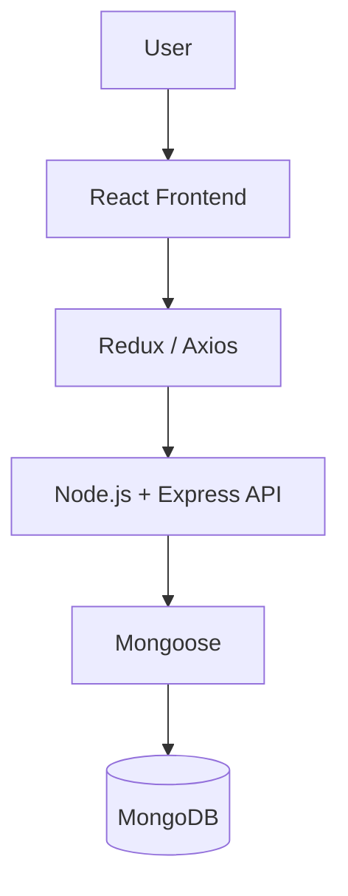

AutoSales — Vehicle Sales Management System
Full-stack web application | MERN Stack | Academic Portfolio Project
Overview
AutoSales is a web application developed around the management of vehicle sales and related sales-promise processes. The project explores how a digital platform can connect a user interface, an API, and a database to support an automotive sales workflow.

The repository contains a React frontend and a Node.js/Express backend, with MongoDB integration through Mongoose.
Technology Stack
Layer	Technologies
Frontend	React, React Router
State management	Redux, Redux Thunk
Backend	Node.js, Express.js
Database	MongoDB, Mongoose
Authentication-related libraries	JSON Web Tokens (JWT), bcryptjs
HTTP communication	Axios
Development tools	Nodemon, Concurrently

Application Structure
promesse-de-vente-/
├── frontend/          # React user interface
├── backend/           # Express server and API
├── package.json       # Root dependencies and scripts
└── README.md
System Architecture

Backend Scope
The server organizes API endpoints related to:
- Users — user-related operations.
- Cars — vehicle-related operations.
The project's dependencies include JWT and bcryptjs for authentication-related functionality. Individual user flows and any document-generation functionality should be verified against the code before being described as complete features.
Getting Started
Prerequisites
- Node.js and npm
- MongoDB or a MongoDB connection URI
Install dependencies
npm install
npm install --prefix frontend
Configure environment
Check the backend configuration for the required environment variables and provide them locally. Never commit passwords, tokens, connection strings containing credentials, or .env files with real values.
Start the application
From the repository root:
npm run dev
Other scripts available in the root package.json:
npm run server   # Backend development server
npm run client   # Frontend development server
npm start        # Backend server
The setup steps describe the repository scripts; successful execution depends on the local environment, configuration, and dependency compatibility. The application has not been independently verified in a current production environment.

Skills Demonstrated
- Full-stack application structure with frontend and backend separation
- REST API integration using React and Express
- MongoDB data access through Mongoose
- State management with Redux
- JavaScript application development and debugging
Project Status
Portfolio / academic project. This repository demonstrates a full-stack architecture and is not presented as a production-ready vehicle sales platform. Features should be assessed against the implementation.
Author
Nadine Ben Taziri

GitHub: nadinebentaziri
